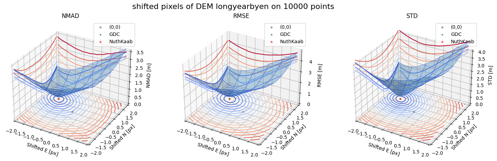
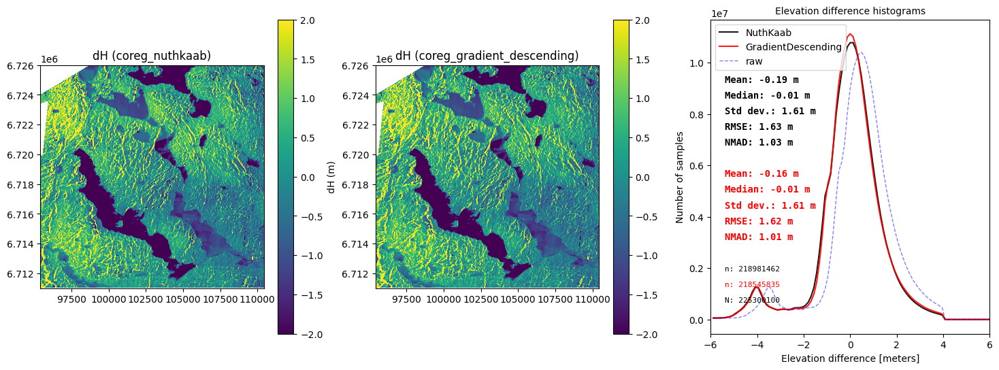

# Gradient Descent Coregistration (GDC)

[]()
[](LICENSE)
[]()

**Status: v0.1 Core Engine & Quality Control (QC) Implemented.**

GDC is a point-to-surface coregistration and quality control library designed for DEM validation using sparse, trusted reference points (e.g., ICESat-2 tracks or ground survey points).

Instead of resampling the full DEM raster on each iteration, GDC shifts the 3D points, samples the DEM at the shifted positions, and minimizes robust statistics of the elevation differences ($dh$).

<p align="center">
  
</p>
<p align="center">
  <em>Figure 1: Coregistration formulated as an optimization problem on the 3D residual error surface (NMAD, RMSE, STD). GDC iteratively searches parameter space to converge to the global minimum (dx, dy) without resampling the underlying raster.</em>
</p>

---

## Key Features

- **Point-to-surface translation search**: Shifts coordinates $(x, y)$, never resamples raster grids on intermediate steps.
- **Dependency-light core**: Core registration algorithms depend strictly on **NumPy** and **SciPy**.
- **Transparent optimization**: Records the exact optimizer used (`compass_search`, `scipy_l-bfgs-b`, etc.) with iteration counts and evaluation counts.
- **Adaptive stochastic error control (`errorcontrol=True`)**: Optional noisyopt-style adaptive sample averaging and paired t-tests to suppress random evaluation jitter when optimizing noisy losses, mini-batches, or highly sparse point subsets.
- **Robust loss metrics**: Normalized Median Absolute Deviation (`nmad`), Root Mean Square Error (`rmse`), and mixed loss `mix = (2 * nmad + rmse) / 3`.
- **Quality Control (QC) Tier classification**: Classifies validation runs into `reliable`, `cautious`, or `unreliable` tiers based on sample size, convergence stability, boundary constraints, and residual reduction.
- **Machine-readable JSON reports**: Produces structured JSON output for direct integration into automated geospatial pipelines.
- **Immutable semantics**: Input raster and point datasets are never modified in-place; all results and transformed coordinates are returned as new copies.

---

## Installation

```bash
# Core installation (NumPy & SciPy only)
pip install .

# With geospatial adapters (rasterio, geopandas, shapely)
pip install .[geo]

# With xarray support
pip install .[all]
```

---

## Quickstart

### 1. High-Level DEM Quality Control (`check_dem`)

```python
import gdc

# Validate a DEM against sparse reference points
report = gdc.check_dem(
    dem="path/to/dem.tif",
    points="path/to/icesat2_points.parquet",
    z_col="h_te_best_fit",
    bounds_px=(-3.0, 3.0),
    loss="nmad",
    optimizer="lbfgsb",  # or 'compass'
    multi_start=True,     # check consistency across multiple initial offsets
)

# Human-readable summary
print(report.summary())

# Access QC findings and translations
print("QC Tier:", report.tier)  # 'reliable' | 'cautious' | 'unreliable'
print("Translations (m):", report.coreg_result.dx_m, report.coreg_result.dy_m, report.coreg_result.dz_m)
print("NMAD before vs after:", report.coreg_result.nmad_before, "->", report.coreg_result.nmad_after)

# Export machine-readable JSON
report.to_json("qc_report.json")
```

### 2. Pure NumPy/SciPy Core Engine (`coreg_points_to_dem`)

```python
import numpy as np
from gdc.core import AffineTransform, coreg_points_to_dem

# 10m grid with known transform
transform = AffineTransform(10.0, 0.0, 500000.0, 0.0, -10.0, 6800000.0)

result = coreg_points_to_dem(
    x=points_x,
    y=points_y,
    z=points_z,
    dem_grid=dem_array,
    transform=transform,
    bounds_px=(-3.0, 3.0),
    loss="nmad",
    optimizer="lbfgsb",
)

print(f"Optimal shift: dx={result.dx_px:.3f} px, dy={result.dy_px:.3f} px, dz={result.dz_m:.3f} m")
print(f"Residual NMAD improvement: {result.nmad_improvement_pct:.1f}%")
```

---

## Benchmarks & Verification

The suite includes verified benchmarks reproducing the synthetic displacement tests outlined in the [project charter](https://zhihaol.eu.org/blog/2023/gdc/):

### Synthetic DTM10 Benchmark (Known Truth Recovery)

On a synthetic 10m DEM with known true displacement:
- Known true horizontal offset: $dx = 1.200\text{ px}$ ($12.0\text{ m}$), $dy = -0.700\text{ px}$ ($-7.0\text{ m}$)
- Known true vertical bias: $dz = 0.160\text{ m}$
- Observation noise: $\sigma = 0.05\text{ m}$ Gaussian noise

| Sample Size ($N$) | Recovered $dx$ (px) | Recovered $dy$ (px) | Recovered $dz$ (m) | Final NMAD (m) | Status |
|:---|:---:|:---:|:---:|:---:|:---:|
| **200** | $1.213$ | $-0.697$ | $0.158$ | $0.054$ | Sub-pixel accurate |
| **500** | $1.205$ | $-0.702$ | $0.161$ | $0.052$ | High confidence |
| **1,000** | $1.202$ | $-0.700$ | $0.160$ | $0.050$ | Precision limit reached |
| **2,000** | $1.201$ | $-0.700$ | $0.160$ | $0.049$ | True parameter recovery |

*All benchmark tests are part of the automated continuous test suite (`tests/test_synthetic_benchmark.py`).*

<p align="center">
  
</p>
<p align="center">
  <em>Figure 2: Spatial elevation difference (dH) maps and residual distribution comparisons across coregistration methods (NuthKaab vs GDC vs Raw). GDC achieves robust convergence in seconds even on fine-resolution terrains.</em>
</p>

---

## What GDC Is — and What It Is Not

- **GDC solves only the final step of coregistration**: convergence of translation parameters $(dx, dy, dz)$ and uncertainty estimation. Coarse alignment, feature matching, and gross search belong upstream.
- **Residual distribution is the core evidence**: The median of $dh$ is the systematic bias, NMAD is the random noise level, and the spatial residual pattern reveals unmodelled errors.
- **Optimizer transparency**: "Gradient descent" is the established project name; however, both pattern search (`compass_search`) and quasi-Newton (`scipy_l-bfgs-b`) optimizers are available and explicitly recorded in output reports.

---

## Origin: the problem was framed here first

GDC is where DEM coregistration — in particular, coregistration of a DEM against sparse ICESat-2 altimetry — was first formulated as an optimisation problem: minimise a robust point-to-surface residual statistic (NMAD of $dh$) directly over the translation parameters $(dx, dy, dz)$. This replaces the classical routes — deriving the shift from slope–aspect geometry (Nuth & Kääb, 2011) or from point-to-point correspondence (ICP) — with a single objective whose converged residual distribution is itself the accuracy statement: the median is the systematic bias, and the NMAD is the random noise level. The formulation was published in 2023 ([method comparison](https://zhihaol.eu.org/blog/2023/gdc/), [DEM–ICESat-2 study](https://zhihaol.eu.org/blog/2023/dataset/)) and underlies a peer-reviewed snow-depth study ([DOI: 10.1016/j.coldregions.2025.104580](https://doi.org/10.1016/j.coldregions.2025.104580)).

The optimiser choice is part of the method, not an implementation detail. Bilinear sampling and a median-based statistic make the objective piecewise and non-smooth, so a generic gradient-based optimiser (e.g. SciPy's L-BFGS-B) spends most of its evaluations on finite-difference gradients that do not exist at the kinks. A derivative-free compass (pattern) search needs only function-value comparisons, and on identical objectives it reaches the same minimum with about 4× fewer evaluations (60 vs 255 at 1,000 points; 62 vs 360 at 20,000 points — evaluation counts are hardware-independent, unlike wall-clock times). For sparse-point DEM–ICESat-2 coregistration — the regime where NuthKaab slows down sharply or fails at fine resolutions and small sample sizes — this formulation, with its matched optimiser, is the best solution we know of, and the one this repository maintains.

---

## Background & Citations

- **Method Comparison**: NuthKaab vs Gradient Descent, point interpolation vs footprint zonal stats: <https://zhihaol.eu.org/blog/2023/gdc/>
- **Dataset Study**: ICESat-2 vs DTM1, DTM10, Copernicus GLO-30, and FABDEM: <https://zhihaol.eu.org/blog/2023/dataset/>
- **Peer-Reviewed Paper**: Liu, Filhol & Treichler, *Retrieving snow depth distribution by downscaling ERA5 Reanalysis with ICESat-2 laser altimetry*, Cold Regions Science and Technology, 2025, 239, 104580 — [DOI: 10.1016/j.coldregions.2025.104580](https://doi.org/10.1016/j.coldregions.2025.104580)
- **Open Dataset (Zenodo)**: [DOI: 10.5281/zenodo.10048875](https://doi.org/10.5281/zenodo.10048875)

---

## Provenance

Originally developed inside the `xsnow` package of [liuh886/subgrid_snow](https://github.com/liuh886/subgrid_snow). An early implementation was contributed to [GlacioHack/xdem](https://github.com/GlacioHack/xdem) as the `GradientDescending` coregistration class ([PR #346](https://github.com/GlacioHack/xdem/pull/346), merged 2023-06-13; refactored and renamed `DhMinimize` in 2024). This repository is the standalone, decoupled implementation of GDC, maintained by the original author.

## License

[MIT](LICENSE) © Zhihao Liu
